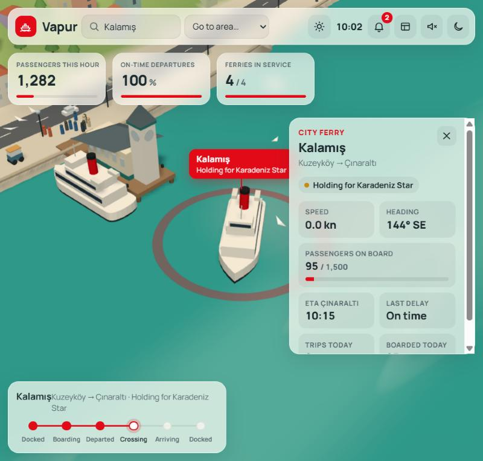

# canli-dunyalar · Living worlds

Single-file, living 3D "operations dashboard" worlds built with Three.js — one `index.html` each, no build step, tuned to run on a laptop iGPU.

| World | What it is | Open |
|---|---|---|
| **Vapur** | Istanbul-style strait: ferries on a timetable give way to a tanker, poyraz / lodos / fog weather, night with a colour-cycling bridge | `worlds/vapur/index.html` |

## How they're made
Each world comes from one prompt in `prompts/`, written with a six-block template (`prompts/template.md`):
World, Life, Interaction, Dashboard, Extras (structure popularised by the free *World Prompt Pack* by @sanjai.builds) plus our own **Performance** block for low-end GPUs.

URL flags: `?low` (no shadows, fewer particles) · `?record` (hides the UI chrome and starts a cinematic camera, for screen capture).

Built with Claude Code (Claude Opus 5.5). Code: MIT.
